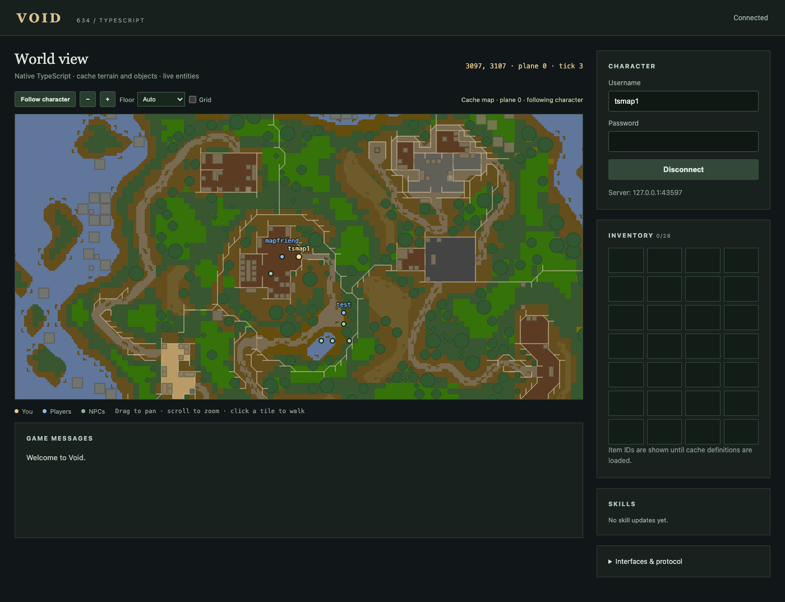

# Void TypeScript client

An incremental, native TypeScript client for Void revision 634, with one shared protocol/state core for browser and lightweight headless runtimes.

This is a **2D cache-map client**, not a finished 3D RuneScape client. It implements actual login encryption, reads game packets, tracks characters and NPC positions, and sends ordinary gameplay instructions. Terrain colours, walls, tree/furniture footprints and object names are read directly from the prepared cache. It does not wrap or embed the Kotlin client. The 3D renderer, general asset loading, interface scripting and broad gameplay coverage remain to be ported.

## Run the browser

Requires Bun 1.4.3 or compatible. Runtime code has no third-party dependencies.

```sh
bun install
bun run dev
```

Open http://127.0.0.1:8082. Set `VOID_CACHE_PATH` in `.env` to a prepared Void cache directory to enable the map background. The local relay connects to a Void game server on `127.0.0.1:43594`. Log in with a local account. Click a tile or press an arrow key to request movement. The displayed position changes only when the server reports it. Drag to pan, scroll or use +/− to zoom, select a floor, and use **Follow character** to recenter. Hover over a tile to see its coordinates and named objects. Names decoded from player appearance packets are drawn above player dots, with nearby labels staggered to avoid overlap. Click-to-walk is disabled when viewing a different floor.

Configure a different server without editing code:

```sh
VOID_HOST=127.0.0.1 VOID_PORT=43597 PORT=8082 bun run dev
```

`VOID_RSA_MODULUS` overrides the public login modulus if the server uses a different key. The development relay binds to localhost and only forwards to the configured game server. It is not production hosting infrastructure.

The browser console exposes `window.voidClient`, the current `Session`. Examples:

```js
voidClient.world.snapshot()
await voidClient.walkTo(3223, 3218)
voidClient.interactNpc(42) // first NPC option; use an index from current state
voidClient.continueDialogue(242, 6)
```

## Run headless

No browser, canvas, DOM or rendering is created:

```sh
VOID_USERNAME=mytest VOID_PASSWORD=localpassword bun run headless
```

The CLI prints state snapshots as JSON lines. Credentials are read from environment variables, not command-line arguments. `VOID_HOST`, `VOID_PORT` and `VOID_RSA_MODULUS` work in both runtimes. Disconnects, login errors and malformed supported packets terminate the session visibly.

For scripts:

```ts
import { connectHeadless } from './src/headless/connect.ts';

const client = await connectHeadless({
  username: process.env.VOID_USERNAME!,
  password: process.env.VOID_PASSWORD!,
});
try {
  await client.waitFor(world => world.player !== null);
  console.log(client.world.snapshot());
  // walkTo waits for the server-reported destination, with a timeout.
} finally {
  client.close();
}
```

## Current coverage

- Revision 634 login using RSA, XTEA, and independent ISAAC streams.
- Incremental packet framing across arbitrary TCP/WebSocket boundaries.
- Initial static-region coordinates, player tracking and movement, NPC additions/movement/removal.
- Full/incremental inventory containers, skill updates, run energy, interface text/open/close and game messages.
- Movement, first NPC/object options, interface options and dialog continuation commands.
- Shared state observation and effects-based waiting, login/idle timeouts and connection cleanup.
- Read-only JS5 disk-cache archives, reference tables, multi-file splitting, terrain and object definitions.
- Streaming 2D map background with automatic region loading, floor/bridge handling, pan/zoom/follow, grid toggle and object hover details.
- Player display names from appearance updates, including correct mask ordering and variable-length hit blocks.
- Zone headers, batched updates, live object additions/removals and reset-to-cache behavior when a zone refreshes.
- Responsive browser entity map, inventory/skills panels and packet diagnostics.

Not yet implemented:

- 3D scene, terrain, models, animation, textures, item icons and audio.
- Network JS5 downloading. Maps currently use a configured local prepared cache (uncompressed/gzip archives); original BZIP2/encrypted caches need preparation first. Item/NPC definitions are still not loaded, so inventory items remain IDs.
- ClientScript/interface VM and the original game interface layout.
- Player appearance names are extracted and other known player mask fields are consumed to preserve alignment. Player hit/animation data is not yet exposed as state. NPC visual masks are still skipped; NPC type IDs can be stale after a transform.
- Ground items, derived map collision and local route planning. Walk requests use Void's ordinary server-side pathfinding. Drawn footprints are a visualization, not a collision oracle.
- Instanced/dynamic regions. They currently stop the session with an explicit unsupported error instead of exposing incorrect coordinates.
- Automatic reconnection and a complete rs-sdk-compatible action library.
- Non-ASCII outbound protocol text; unsupported text is rejected before transmission.

Framed but unsupported packet types are counted in `world.unhandled`. A successful dispatch is not proof of a successful game action. Use `waitFor`/`walkTo` to observe effects.

## Check and build

```sh
bun run check
```

The tests cover known ISAAC/XTEA vectors, fragmented framing through cipher regeneration, source-derived state fixtures, malformed input, cache sector chains/chunk tables, terrain orientation/bridges, coordinate projection, player names and mask ordering, live object update layouts and a local TCP integration peer with a generated RSA key. **The peer is a test fixture, not a game server.** The TCP test requires permission to listen on localhost.

`bun run build` writes browser assets to `dist/`. A compatible `/game` WebSocket relay and `/config` endpoint are still required when serving those assets; static hosting alone cannot connect to the game's TCP server.

## Cache and server setup

`../rs2-file-server` is a cache distributor. It requires an existing cache and does not contain or download one.

Void expects its prepared cache, not just any original revision 634 cache. Its [installation guide](https://github.com/GregHib/void/blob/master/docs/Installation-Guide.md) links the prepared-cache folder. Its [cache-building guide](https://github.com/GregHib/void/blob/master/docs/Cache-Building.md) describes the original-cache conversion route.

An isolated runtime for development was prepared under `/private/tmp/void-live-test/`: Void 2.11.0, a temporary Java 21 runtime, and the 2026-08-02 prepared cache. Test saves/configuration live there, separately from the source repositories and the original cache. See `VALIDATION.md` for actual test results.

## Next implementation steps

1. Derive collision and local routing from the decoded terrain/objects.
2. Decode NPC names/transformations and expose combat state from visual masks.
3. Port one scene/rendering path from the Kotlin client, comparing against reference scenes.
4. Port interface definitions and ClientScript execution for native game interfaces.
5. Expand action coverage and recovery using observed gameplay effects.

The existing Kotlin browser client remains the behavioral and visual reference. The headless runtime should keep sharing the same state/action core as the browser runtime.

## Map cache and headless access

For the current local runtime:

```sh
VOID_CACHE_PATH=/private/tmp/void-live-test/prepared-cache VOID_PORT=43597 bun run dev
```

The development server exposes `/map/region/{x}/{y}` (64×64 tiles across four planes) and `/map/object/{id}`. Cache data is static baseline data; per-session zone packets supply live object replacements. Region payloads are cached in memory with bounded retention. Missing or unsupported cache data is reported in the map status without stopping the game connection.

The canvas is a schematic minimap: it uses cache floor colours and placed objects but does not reproduce the original minimap's texture averaging, lighting, map-scene sprites or every overlay shape exactly. Instanced regions remain unsupported.

The lightweight runtime can use the same decoder/store without loading DOM or rendering code:

```ts
import { DiskCache, RegionStore } from './src/index.ts';

const cache = new DiskCache(process.env.VOID_CACHE_PATH!);
try {
  const maps = new RegionStore({ region: async (x,y) => cache.region(x,y) });
  await maps.load(48,48);
  console.log(maps.regions.get('48:48')?.objects);
} finally {
  cache.close();
}
```


