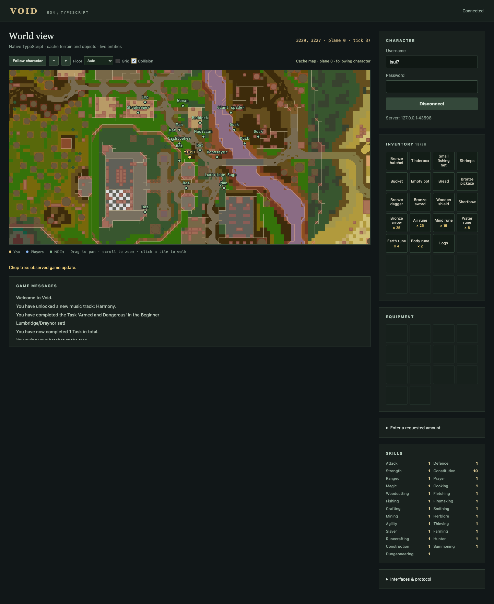

# rs2011-ts

Contributor handoff: [project context](PROJECT_CONTEXT.md) · [backlog](TODO.md) · [agent guide](AGENTS.md).

A native TypeScript client and developing automation SDK for Void’s RuneScape revision 634 server. Browser and lightweight headless clients share the same encrypted protocol, state, cache decoders, queries and actions. The browser currently renders a schematic 2D map from real cache terrain and placements.

## Run locally

Requires Bun 1.4.3 or compatible, a running Void server and its **prepared revision 634 cache**. Runtime code has no third-party dependencies.

```sh
bun install
cp .env.example .env
# Edit VOID_PORT and VOID_CACHE_PATH in .env.
bun run dev
```

Open http://127.0.0.1:8082. The relay binds to localhost and connects to the configured TCP game server. `VOID_HOST`, `VOID_PORT`, `PORT`, `VOID_CACHE_PATH` and optional `VOID_RSA_MODULUS` configure it without source changes.

The current local runtime lives in the gitignored `dev/` directory, including Java, the server, prepared cache, and player saves. Start each service in a separate terminal:

```sh
bun run dev:game
bun run dev:lite
bun run dev:gateway
bun run dev:full
```

The game port is `43597`; lightweight and regular clients are at http://127.0.0.1:8082 and http://127.0.0.1:8083. See [local development setup and shutdown](docs/local-development.md) for layout, configuration, and backups.

Browser controls:

- Click an open tile to walk along an observed route with automatic door handling. Click an object/NPC or right-click a tile for actions. Doors and gates have square markers on their actual wall edges: amber when closed, green when open. Click the marker or its Door/Gate label for **Open** or **Close**, including on rotated doors and either half of a double gate. Hover and right-click use the same target. Tutorial progression checks still apply.
- Drag to pan; scroll or use +/− to zoom; use **Follow character**, floor, grid and collision controls. Player and NPC names appear above their dots.
- Click named inventory/equipment items for actions. Bank windows expose deposit/withdraw menus and a deposit-inventory button.
- First-login character creation offers sex selection and confirmation of the current appearance; the full client provides the visual appearance editor. Tutorial instruction text is displayed when open.
- Dialogue text and choices come from server text updates and IF3 cache components. Click the actual labelled choice or continue button.
- Action status distinguishes raw dispatches from helpers that observed a game update. The optional amount form submits a number only when the game requests one.

The console exposes `window.rs2011 = {sdk, bot, session, map}`. `window.voidClient` and `window.voidMap` remain available for existing debugging scripts.

```js
rs2011.sdk.getState().snapshot()
await rs2011.sdk.findNearbyObject('Tree')
await rs2011.bot.chopTree(await rs2011.sdk.findNearbyObject('Tree'))
```

## Headless SDK

No browser, canvas or DOM is created:

```sh
VOID_USERNAME=mytest VOID_PASSWORD=localpassword bun run headless
```

The snapshot CLI and examples read credentials from environment variables. Do not connect two controllers to the same character.

```ts
import {connectHeadless, DiskCache, BotSDK, BotActions} from './src/index.ts';

const cache = new DiskCache(process.env.VOID_CACHE_PATH!);
const session = await connectHeadless({
  username: process.env.VOID_USERNAME!,
  password: process.env.VOID_PASSWORD!,
  port: Number(process.env.VOID_PORT ?? 43594),
});
const sdk = new BotSDK(session, cache);
const bot = new BotActions(sdk);
try {
  await session.waitFor(w => w.player !== null && w.skills.size > 0);
  console.log(sdk.getState().snapshot());
  const tree = await sdk.findNearbyObject('Tree');
  if (tree) console.log(await bot.chopTree(tree));
} finally {
  session.close();
  cache.close();
}
```

`BotSDK` provides inventory/equipment/bank queries, item/NPC/object names and options, nearby searches, dialogue buttons, collision and cache-backed multi-region routes. Cache-backed queries are asynchronous. `BotActions` provides observed walking, object/NPC interaction with an explicit effect predicate, woodcutting, equipment, banking, modal closing and simple dialogue dismissal. Actions on one `BotActions` instance are serialized by rejecting overlapping calls. They time out or reject on disconnect rather than declaring dispatches successful.

Use `Session` for raw packets. NPC/object option numbers are **zero-based cache slots**, including empty slots; interface options are zero-based 0–9. Inventory cache options have a separate revision-specific mapping, handled by the SDK/UI.

A repeatable mainland example lives in [examples/woodcut-bank.ts](examples/woodcut-bank.ts): regular tree → observed logs and XP → castle stairs → bank deposit → withdrawal → close. It uses ordinary game packets, a real bronze hatchet and the normal starting inventory. Run it on a dedicated Lumbridge character with free inventory space:

```sh
VOID_USERNAME=mytest VOID_PASSWORD=localpassword bun run example:woodcut-bank
```

Finish the tutorial first, or use a separate test server configured for mainland starts. The example leaves the character at Lumbridge bank with one log in inventory. It can descend the castle stairs on a later run. It reports missing/depleted trees or blocked routes explicitly.

## Initial inventory synchronization

`getInventoryStatus()` and `getEquipmentStatus()` return `unknown`, `partial`, or `complete`. An empty item array before a complete snapshot does not establish that a character has no items. The lightweight UI now displays that distinction.

Void can omit pre-login inventory and skills while Tutorial Island's sidebar tabs are locked, even though later item updates arrive. The optional [read-only login-state listener](compat/void/README.md) sends the ordinary inventory/equipment/skill snapshots at login without unlocking tabs or changing tutorial progress. Use it when the SDK needs complete state at every tutorial stage. The original server JAR and character saves are not modified by the overlay.

## NPC dialogue

The lightweight client has a visible conversation panel, nearby **Talk** buttons, labelled choices and Space/number shortcuts. The SDK exposes observed conversation helpers:

```ts
await bot.talkTo('Guardsman Peale');
await bot.navigateDialog(); // continue speech, stop at the first unanswered choice
const dialog = await sdk.getDialog();
await bot.chooseDialogOption('Tell me about Lumbridge.', {expected: dialog!});
await bot.navigateDialog(['Bye.']);
```

See [the dialogue guide](docs/dialogue.md) for snapshots, `continueDialog`, choice matching, stale-snapshot checks, low-level dispatches, limits, and the [runnable example](examples/npc-dialogue.ts).

## Implemented and remaining work

Implemented: RSA/XTEA/ISAAC login; fragmented framing; static-region/player/NPC movement; player names; containers/skills/messages; live object replacement; read-only JS5 archives, terrain, object/item/NPC definitions; IF3 text/actions; NPC variable-selected forms and server-sent NPC transforms; window/mount/visibility updates; all five NPC/object options; equipment and common dialogue/bank controls; collision-aware multi-region walking with door handling; shared browser/headless helpers.

Routing uses terrain flags, rotated footprints, directional walls, bridges and live object overrides. Unknown tiles are blocked and diagonal corner cutting is prevented. Paths are previews; the server remains authoritative. Routes span a local 52-tile window and use short, observed waypoints. Doors require explicit interaction. Dynamic object morphs and mobile entity occupancy are not yet fully modelled.

Remaining: 3D models/animation/textures, original interface layout and ClientScript VM, item icons/audio, combat state, NPC hit/animation evidence, broad crafting/shop/quest helpers, automatic recovery/reconnection. Instanced map decoding projects cache chunks into live destination coordinates; quest-specific cutscene and interface coverage still varies. The amount form sends requested inputs but does not implement the general ClientScript input UI. This is an initial SDK, with a smaller API than rs-sdk.

The schematic map uses actual floor colours and placements; overlay masks and object drawings are approximations. Collision shading marks blocked tiles; walls remain visible as lines. Non-ASCII outbound text is currently rejected. Unsupported framed server packets are counted in `world.unhandled`.

## Validation and build

```sh
bun run check
# Also exercise local prepared-cache integration:
VOID_CACHE_PATH=/path/to/prepared-cache bun run check
```

Tests cover cipher vectors, framing, source-derived packets, TCP login/cleanup, all object/NPC option encodings, names, cache corruption checks, IF3 controls, routing and effect-based action completion. The TCP peer is a protocol fixture, not a game server. [VALIDATION.md](VALIDATION.md) records separate real-server/headless/Chromium gameplay checks.

`bun run build` emits browser assets in `dist/`. Serving them still requires `/game` (WebSocket/TCP relay), `/config`, `/map/region/{x}/{y}`, `/map/object/{id}` and `/definitions/{item|npc|interface|varbit}/{id}` endpoints. Static hosting alone cannot connect to the TCP game server.

Void’s [installation guide](https://github.com/GregHib/void/blob/master/docs/Installation-Guide.md) links its prepared cache; its [cache-building guide](https://github.com/GregHib/void/blob/master/docs/Cache-Building.md) covers conversion. The local `2011scape/rs2-file-server` distributes an existing cache; it does not supply one. Original BZIP2/encrypted caches need preparation; the current disk adapter supports none/gzip containers.

Source references and BSD notices are in [THIRD_PARTY.md](THIRD_PARTY.md). No server binaries, game cache or credentials are included in this repository.



## Inventory use, dropping and ground items

Choose **Use …** on an inventory item, then click a second slot. The selected source is highlighted; Escape or Cancel clears it. Drop waits for inventory removal before reporting success. Nearby ground items show names, quantities and coordinates, with **Take** buttons; purple squares mark their tiles on the map. Map menus also offer pickup. Only items the server exposes to your character are shown.

```ts
const tinderbox = await sdk.findInventoryItem('Tinderbox');
const logs = await sdk.findInventoryItem('Logs');
await bot.useItemOnItem(tinderbox!, logs!); // observes inventory change or a new dialogue
// Or, for firemaking completion specifically:
await bot.burnLogs((await sdk.findInventoryItem('Logs'))!); // requires consumption + XP
await bot.dropItem((await sdk.findInventoryItem('Logs'))!);
const ground = await sdk.findGroundItem('Logs');
if (ground) await bot.pickupItem(ground);
```

`getGroundItems(radius = 24)` returns visible, same-floor stacks sorted by distance; each has a session-local `key`, item `id`, `amount`, `x`, `y`, and `level`. `findGroundItem` resolves cache names. Raw `sendUseItemOnItem(sourceSlotOrItem, targetSlotOrItem)`, `sendDropItem(slotOrItem)` and `sendTakeGroundItem(groundItem)` dispatch without waiting for a game effect. Query fresh items before acting: slot changes and vanished ground stacks are rejected.

Game tabs expose the server-visible controls, including Options, Inventory and Stats. `await sdk.selectGameTab('Inventory')` sends the normal tab click; it does not unlock a tab. On Tutorial Island, follow the Guide dialogue and tab instructions before inventory actions unlock. A missing inventory interface is reported separately from an actual bank/deposit modal. Generic item use confirms a state change, not completion of an entire recipe; use a specific helper or wait for the relevant XP/product evidence.


## Developer command console

Expand **Developer command console** below the map. Choose an example or type JavaScript, then Run or Cmd/Ctrl+Enter. The active character is displayed beside the button. The console exposes the current `sdk`, `bot`, top-level `await`, and captured `console.log`/`info`/`warn`/`error`/`table`. A single expression displays its result; multiline commands can use `return`:

```js
await sdk.selectGameTab('Stats')
```

```js
const logs = await sdk.findInventoryItem('Logs');
if (!logs) throw new Error('No logs in inventory');
return await bot.dropItem(logs);
```

Commands run locally in the page on the connected character; no command execution endpoint is exposed by the relay. Runs are serialized, results/errors use plain text, and output is bounded. Variables are local to each run and command history is not persisted. This is JavaScript (no TypeScript type annotations). Use short diagnostic commands; there is no script cancellation control. Disconnecting terminates session-backed waits. Raw `sdk.send*` calls and `selectGameTab` report dispatch, while `bot.*` helpers observe the method-specific evidence documented above.

The **Open Inventory tab** button sits above the inventory. It enables when the server exposes that tab. A locked tutorial inventory shows contextual instructions instead of claiming a modal is open. At the opening tutorial stage, talk to the RuneScape Guide, follow the Options-tab prompt, then the Survival Expert; simply selecting an unavailable Inventory tab cannot unlock it.

If `getGameTabs()` returns `[]`, run `await sdk.getGameTabStatus()` to see the active window, visible tabs, and the current tutorial instruction. At stage 0, every tab is hidden by the server. Start with `await bot.talkTo('RuneScape guide')` and progress the conversation with the dialogue panel or `await bot.navigateDialog()`. Once the Options tab appears, select it when prompted. Inventory unlocks later at the Survival Expert step. A tab click cannot skip these server-side stages.


## Player activity

A player activity badge above the map shows Idle, Walking/Running, Animating, In dialogue or Resting. Movement and animation updates come from the server; a clicked command alone does not change the badge. Animation end times are estimated from revision 634 cache timings, including delay and loops. The badge becomes unknown when updates are stale or animation timing cannot be read, and disconnected when the session ends. Hover for details. Idle means no observed movement or active animation; it is not a guarantee that the server has no queued action.

## Emotes and run mode

The developer console and SDK support named revision 634 emotes and explicit run mode:

```js
await sdk.performEmote('Wave'); // opens the Emotes tab automatically
```

```js
await sdk.setRunning(true); // enable run; false disables it
```

Use `await sdk.getEmotes()` for cache-defined names and `sdk.getRunState()` for the current mode, availability and run energy. The **Enable run / Disable run** button above the map shows the same server-confirmed state and energy. `setRunning` is idempotent and waits for a server movement update; it rejects unknown, resting or unavailable states rather than guessing.

`performEmote` confirms dispatch, not animation completion. Wait for the animation to finish before sending another interface action: the server can ignore clicks while an emote is playing, even after tutorial instructions change. The emote catalogue does not guarantee that quest/event emotes are unlocked; the server enforces those requirements. During Tutorial Island, perform an emote when prompted, let it finish, then enable run. If run was already enabled before that tutorial step, explicitly disable and enable it so the tutorial receives the required click.

All four methods are also available through the remote gateway; await remote queries, including `await sdk.getRunState()`.

## Quest start screen

Some quests (for example The Restless Ghost) open the revision 634 quest intro screen (interface 178, "Start this quest?"). `getDialog()` exposes the visible Yes/No choices. For structured details use `await sdk.getQuestOffer()`, then `await sdk.acceptQuest()` or `await sdk.declineQuest()`. Hidden required-item/reward text is omitted until `revealQuestOffer('items'|'rewards')` clicks the game's reveal control. Quest helpers are available through the gateway. See [SDK actions and state](docs/sdk-actions-and-state.md) for quest progress, journal, points, cancellation, banking, reachability and Auto Retaliate APIs.

## Nearby objects

Transit objects have cyan diamond markers on the map: ladders, stairs, trapdoors/hatches, cave entrances, portals, gangplanks, pullable levers and other objects with travel or shortcut actions. One-way ladders/stairs show an up/down arrow and direction label. Click a marker or its label to choose the object's cache-defined action, including **Climb-down** on the Tutorial Island basement ladder. Closed trapdoors offer Open; live object updates switch the menu to the opened object's actions. Markers use the current floor and respect bridge levels. Doors and gates retain their amber/green markers. Labels appear when zoomed in; icons remain clickable when zoomed out.

The lightweight **Nearby objects** panel lists interactive objects within 16 tiles, nearest first. Filter by name and choose **Actions** for the cache-defined menu. Map menus expose the same actions. The SDK can query a wider local area and dispatch the named action:

```js
const door = await sdk.findNearbyObject(/^door$/i);
if (!door) throw new Error('No nearby door');
sdk.sendObjectOption(door, 'Open');
```

`sendObjectOption(target, option)` accepts a label, regular expression, or zero-based cache option slot (empty slots are not renumbered). It rejects changed objects, unavailable actions, wrong floors and targets outside the local interaction area. It sends a request; server rules and pathfinding determine the outcome. For observed effects, use `await bot.interactObject(target, option, world => /* expected change */)` with an explicit predicate, or a specialized helper such as `chopTree`.

The optional [Void compatibility overlay](compat/void/README.md) also supports a tutorial starting-door fix. It prevents shared open-door bypasses while letting accounts already stranded outside return to the Guide. It does not mark those accounts' tutorial steps complete.


Firemaking on path tiles uses the optional Void fire-placement fix described in the compatibility guide. The original server rejected nonblocking floor decorations as though they were solid objects. The fix retains existing-fire and doorway restrictions. The lightweight client's tinderbox/log combination now uses the firemaking helper so it waits for XP, and displays server refusal messages beside the inventory. Generic item use no longer treats a tutorial-instruction redraw as successful recipe progress. Inventory buttons stay mounted through unrelated world updates, avoiding clicks being lost while entities update.


## NPC transforms

The server can replace an NPC's type in place: a sheared sheep, a defeated quest cultist who only offers Talk-to afterwards, a creature changing form. Revision 634 carries this in the NPC update packet's visual mask block, which the decoder now reads in full. `nearbyNpcs()`, `findNearbyNpc()`, `talkTo()` and `sendNpcOption()` resolve names and options from the NPC's current type, so an option that disappeared on the server disappears locally in the same tick. An entity captured before the change is rejected with "NPC changed or left view"; query again and act on the fresh entity. Cache-defined varbit/varp forms are resolved as before.

The remaining mask fields (animation, hits, facing, graphics, overhead text, model changes) are consumed to stay aligned but are not yet exposed. A block the decoder cannot read is skipped for that tick, counted in `visualBlocksSkipped` and described in `getState().warnings`; positions are unaffected because they precede the masks.

If the local definition is ever known to be wrong, `await sdk.sendNpcOption(npc, 0, {force: true})` sends an explicit slot 0–4 without checking the definition. The result carries `forced: true`; the server still decides what the click does, so observe messages and dialogue as usual. Do not use it as a default: the ordinary validation is what prevents scripts from repeating actions the server answers with "Nothing interesting happens."

## Gateway: hosted clients, local agents

A dedicated gateway now supports persistent remote clients with local SDK controllers and read-only observers. Start `bun run gateway`, run each bot with `bun run client:gateway`, and connect locally with `connectGateway` or `runGatewayScript`. Game passwords and cache stay on the game-client host. Local browser clients started with `bun run dev:lite` automatically publish configured accounts after login. Agents attach by character name without a page button or token entry. The header and favicon show gateway availability and controller attachment; the **SDK gateway** panel retains manual settings and detach. The authenticated fleet listing provides status/positions for dashboard work.

See [remote setup, role tokens, API differences and remaining rs-sdk parity](docs/gateway.md). Generate private per-role credentials with `bun scripts/create-gateway-config.ts botname`; the gateway binds to loopback by default. [examples/remote-bot.ts](examples/remote-bot.ts) demonstrates local scripts attached to a hosted session.

## Cooking and item-on-object use

In the lightweight client, select **Use Raw shrimps…** from the inventory menu, then click the fire on the map and choose **Use Raw shrimps → Fire**. Alternatively, filter Nearby objects by `Fire`, open **Actions**, and choose the same interaction. Fires appear as orange flame markers labelled **Fire**, and remain listed in Nearby objects even though their cache definitions have no normal menu actions. Clicking a fire without a selected item explains how to use an inventory item on it. Escape cancels the selected item. The server approaches the object and applies the normal cooking rules; a burnt shrimp is a possible result.

```js
const shrimp = await sdk.findInventoryItem(/^raw shrimps$/i);
const fire = await sdk.findNearbyObject(/^fire$/i);
if (!shrimp || !fire) throw new Error('Raw shrimps and a nearby fire required');
const result = await bot.useItemOnObject(shrimp, fire);
if (result.effect === 'dialogue') {
  await sdk.selectRecipeQuantity('all'); // or 1, 5, 10
  await bot.chooseDialogOption(/shrimps/i, { expected: result.dialog });
}
```

A single shrimp cooks directly. Multiple raw items can open the recipe dialogue: choose a quantity, then the named product. Revision 634 generates these choices from server client-variable updates, so the lightweight dialogue panel and SDK decode those variables as well as ordinary text. `useItemOnObject` resolves when the source inventory changes or a recipe dialogue opens; it does not promise a successfully cooked product or a completed batch. Observe the resulting inventory and Cooking XP for that. `sdk.sendUseItemOnObject(itemOrSlot, object)` is the raw dispatch. Both methods and recipe quantity selection are available through the remote gateway.

The separate Kotlin browser client advances animated movement through a paced game loop. When its tab is in the background, browser timer throttling can leave its displayed movement behind the server state. The TypeScript client's tile positions come directly from decoded player updates and do not wait for that animation. This cooking change does not modify the Kotlin client's scheduler.


Tutorial Island hides the normal chat history under its instruction panel. The optional [general tutorial feedback fix](compat/void/README.md#optional-general-tutorial-feedback) mirrors common action refusals into a standard click-to-continue statement, including an insufficient Woodcutting level and `Nothing interesting happens.` from invalid item combinations. Both clients display this server dialogue. The SDK and lightweight action status also recognize Engine message type 4; item-use and object helpers reject fresh server refusals instead of treating the popup as a successful recipe dialogue. Outside Tutorial Island these messages remain chat-only.

## Production across skills

The lightweight **Production** panel and shared SDK now handle named products and quantities beyond cooking, including anvil smithing, smelting, fletching, crafting, jewellery, tanning and dedicated production menus. Use a bronze bar on an anvil while carrying a hammer, then choose **Bronze dagger**. In scripts, open the menu normally, inspect `await sdk.getCreationMenu()`, and call `await bot.create('Bronze dagger', 1)`. Make X prompts have a visible amount form and SDK access. See [production API, interface coverage and limitations](docs/production.md).


## Health, combat styles and equipment stats

The lightweight **Combat** panel shows current and maximum life points and the equipped weapon’s attack styles. HP uses the exact server life-points value, rather than the rounded Constitution skill update. Choose a style to wait for server confirmation; available buttons follow the weapon and tutorial unlocks.

Beside **Equipment**, click **View equipment stats** to open the real equipment-bonuses interface, including the Tutorial Island step. It selects Worn Equipment automatically. The bonuses appear below the equipment slots with a Close button.

```ts
console.log(await sdk.getHealth()); // { current, max, constitutionLevel }
console.log(await sdk.getCombatStyles());
await sdk.selectCombatStyle('Defensive'); // or an exact style label, e.g. 'Lunge'
await sdk.openEquipmentStats();
console.log(await sdk.getEquipmentStats());
await sdk.closeEquipmentStats();
```

These methods also work through the remote gateway. Styles accept a label, mode, RegExp or zero-based index; ambiguous modes reject with the available choices. Selection opens Combat Styles and waits for the authoritative style update, rejecting weapon changes during confirmation. `getCombatState()` includes weapon, selected index, availability and a reason when unavailable. Unknown health or unsynchronized values remain `null`. Maximum HP comes from the base Constitution XP level; current HP can exceed that maximum when boosted. Equipment bonuses preserve server text, including percentages, and remain unknown until received. These controls cover physical attack styles; spell casting and autocast selection use the magic APIs below.

## Prayers and tutorial spell casting

Use **Game tabs → Prayer List** for the tutorial's prayer-interface step. SDK and gateway controllers can also open it and activate/deactivate named prayers:

```ts
await sdk.openPrayerList();
console.log(await sdk.getPrayerState()); // book, points, base maximum, available prayers
await sdk.setPrayer('Thick Skin', true);
await sdk.setPrayer('Thick Skin', false);
```

`getPrayers()` lists the active book's prayers/curses, required levels, membership flags and active states. `setPrayer(nameOrIdOrRegExpOrIndex, enabled, timeout?)` is idempotent, selects Prayer List and waits for the active-state packet. Numeric indices are zero-based button slots, which differ from active-state bit positions. Server updates also reflect incompatible prayers being removed and points running out. Active lists start empty on a fresh Void login; unknown book and skill values stay unknown. Level and point checks are local hints; server rules remain authoritative. Individual activation rejects quick-prayer selection mode. Quick-prayer presets and changing books at an altar are separate controls.

To finish the tutorial's spell step, ask Terrova for runes, then use the developer console preset **Cast Air Strike on a chicken**, or run:

```ts
await sdk.castSpellOnNpc('Air Strike', /^chicken$/i);
```

Revision 634 calls this **Wind Strike**; both names and `wind_strike` are accepted. `getCombatSpells()` lists supported named spells (initially Wind Strike). Casting opens Magic Spellbook, validates the current NPC and spell component, and sends the real spell-on-NPC request. A result observes Magic XP (`effect: 'magic-xp'`) or mind-rune consumption (`effect: 'runes-consumed'`); it does not promise damage or tutorial completion. On this Void server a miss consumes runes without awarding combat XP. Allow the cast animation/cooldown to finish and try again if the tutorial still asks you to cast. Missing runes and other fresh server refusals are reported. Both prayer and casting methods are available through the remote gateway; observers can query but cannot cast or toggle prayers.

## Full spellbook dispatch and Home Teleport

The SDK now lists named spells from the current modern, ancient, lunar or Dungeoneering book, using revision 634 cache target flags. This covers combat, teleports, enchantments and utility spells. The regular game rules still enforce skill levels, runes, quest unlocks, targets and location restrictions.

```ts
console.log(await sdk.getSpells()); // names, ids, target kinds and actions
await sdk.homeTeleport(); // waits for actual Lumbridge arrival
await sdk.castSpell('Varrock Teleport'); // dispatch only
const ring = await sdk.findInventoryItem('Sapphire ring');
if (ring) await sdk.castSpell('Lvl-1 Enchant', {kind:'item', target:ring});
const npc = await sdk.findNearbyNpc(/^chicken$/i);
if (npc) await sdk.castSpell('Wind Strike', {kind:'npc', target:npc});
```

`castSpell(nameOrIdOrRegExp, target?, option?)` returns `dispatched: true`, which means the request was sent. Observe the resulting inventory, XP, dialogue or position to confirm the effect. Target kinds are `npc`, `player`, `self` (target your own character), `item` (inventory item or slot), `object` and `ground-item`. The spell catalogue publishes the permitted kinds; stale local targets and hidden spell components are rejected. An optional action label chooses among self-cast options. Some spells open selection or production menus and need follow-up actions; spell dispatch does not automate those menus or guarantee every server spell is implemented correctly.

`homeTeleport(timeout=45000)` specifically casts **Lumbridge Home Teleport** and observes the server's Lumbridge arrival tiles. Complete Terrova's final conversation first to unlock the Tutorial Island exit. Starting its animation is not success. Cooldowns and fresh server refusals reject the helper. The developer console has a **Home Teleport** preset. Other home destinations can be dispatched by name through `castSpell`; confirmed-arrival handling currently covers Lumbridge. All methods also work through the remote gateway.


## Agent setup and MCP

Open this repository in your coding agent and ask it to start a new bot. The repo's `AGENTS.md` and MCP configuration describe the workflow. Setup creates `bots/{username}/bot.env`, `script.ts` and `lab_log.md` and registers private gateway role tokens without overwriting existing accounts.

```sh
bun bots/create-bot.ts mybot
bun bots/start-client.ts mybot  # persistent lightweight client; leave running
bun bots/state.ts mybot         # observer query
bun bots/mybot/script.ts
```

The MCP server provides `start_bot`, `create_bot`, `execute_code`, `list_bots` and `disconnect_bot`. `execute_code` exposes `sdk` and `bot`, reuses an existing gateway client, or opens/signs into a visible regular client automatically. `start_bot` does startup separately; explicit client modes select the visible lightweight map or headless client. Execution timeout is in seconds (default 120, maximum 3600). Scripts remain in the account's directory. Gateway clients and local agent scripts can run on different machines; game credentials/cache stay on the client host. See [MCP tools, configuration, cancellation and remote setup](mcp/README.md).

## Watch an agent in the regular client

Ask an agent to continue the configured account in the regular client, or call `start_bot({bot_name:'mybot',client:'regular'})`; it opens the window and signs in using saved credentials. For manual use, run `bun run dev:full` and open http://127.0.0.1:8083 (or `/full/` on the lightweight web service). Log into a configured account; it registers automatically with the local gateway. Agents use the same SDK and account directory while ordinary mouse and keyboard input remain available. A header outside the game shows controller identity and connection status. Collapsible companion tools include login, random bot-account generation, gateway controls, a developer command console and SDK action history. See [build/setup instructions and current limitations](compat/void-client/README.md).


The lightweight client's **SDK action log** card records recent agent, developer-console and page-control calls to public SDK/bot action methods. Expand an entry to see its arguments, return value or error and duration. It keeps at most 200 entries in memory, supports clearing, and resets on refresh. Queries and direct `session.*` packet calls are not recorded. “Returned” describes method completion; raw dispatch receipts still require observing the game effect. Existing browser sessions need a later refresh to load this feature.


Long-distance walking uses the revision 634 cache and the attached game session:

```ts
const route = await sdk.planRoute(3212, 3428, {tolerance: 2}); // Read-only; includes doors.
await bot.walkTo(3212, 3428, {timeout: 180000, tolerance: 2}); // Varrock, same floor.
```

`bot.walkTo(x, y, timeoutMs)` remains supported. The options form accepts `timeout` (default 120 seconds, maximum 595 seconds), `tolerance` (default 0), `openDoors` (default true), an optional expected `level`, and planning budgets. It follows short walking legs, observes server arrival, opens named doors/gates along the route and replans after scene changes. A refused door is temporarily excluded; an instructor/tutorial requirement is reported without trying to skip it. Queries and movement both work through the gateway. The gateway gives walking calls their requested duration plus a short response allowance, up to ten minutes; other calls keep their configured timeout.

`planRoute` returns a complete path to within the requested tolerance, with approach/crossing metadata for doors; it never reports a partial path as arrival. `routeTo` returns only the path and keeps closed doors blocked unless `{openDoors:true}` is passed. Unknown cache regions remain blocked. Routes cover up to 1024 tiles of displacement, with bounded search (100,000 visited tiles and 128 region loads by default; configurable up to 250,000/256). Larger detours may need intermediate destinations. This version walks on the current floor: stairs, ladders, boats, quest passages and teleports still require explicit interactions. It does not automatically enable run or select a safe route around hostile NPCs.

Walking stops on stale player state, a detected death, unexpected teleportation/floor changes, repeated lack of progress or its deadline. Gateway controller disconnect/takeover, command expiry and loss of the gateway link stop subsequent walking legs. An already accepted movement leg can finish. Other previously accepted high-level actions retain their documented cancellation behavior. Existing browser clients and the gateway must be updated/restarted after the current run to activate this version; no live session is reloaded automatically.

### Quest offers

Quest-start offers (revision 634 interface 178, with **Start this quest? Yes / No**) appear in `await sdk.getDialog()` with the quest title, requirements, items, combat and rewards. They also use the lightweight client's existing dialogue controls. Agents can inspect the offer and choose explicitly:

```ts
const offer = await sdk.getDialog();
if (offer?.id === 178) {
  console.log(offer.title, offer.lines);
  await bot.chooseDialogOption('Yes', {expected: offer}); // or 'No'
}
```

The existing gateway/MCP dialogue API carries these offers; no automatic acceptance is performed. Published options disappear when the server hides the start-choice controls. A dispatched choice does not by itself establish a quest's subsequent progress.

### Magic combat autocast

```ts
const autocast = await sdk.getAutocastState(); // selected spell and visible choices
await sdk.setAutocast('Air Strike');           // Wind Strike alias
await sdk.setAutocast('Wind Strike');          // idempotent, does not toggle it off
await sdk.setAutocast(null);                   // disable
```

These methods work through the gateway and MCP, including browser-attached regular and lightweight clients. Selection opens Magic Spellbook and waits for the server's autocast variable (revision 634 varp 108). `getAutocastState()` is read-only and does not open a tab. Its choices require a visible combat spell with an Autocast action; Lunar spells are excluded. Spell IDs come from the revision 634 server profiles, not the 2004 SDK.

Setting autocast selects a continuing combat spell; it does not start combat or prove that damage was dealt. The server remains responsible for equipment, level, rune and target restrictions. A staff is not required for this revision: [Jagex removed that requirement on 2 September 2009](https://secure.runescape.com/m=news/changes-to-autocasting-spells). Weapon changes clear autocast server-side. An unknown spell ID remains visible as `castId` with `spell: null`. Disabling requires the selected spell to remain visible in its spellbook because this server toggles Autocast by clicking that same spell. A timeout or refusal rejects the selection and releases its pending-operation guard.

## Action reliability and state queries

Use `sdk.cancelAction()` to cancel a pending cooperative command; `bot.depositItem`/`withdrawItem` now accept item IDs, names or objects and arbitrary positive quantities, and `bot.depositAll()` deposits carried items. `sdk.canReach(target)` inspects walking approaches and blocking doors without moving. `sdk.getAutoRetaliateState()`/`setAutoRetaliate(boolean)` expose confirmed retaliation controls.

Item/object definitions, named inventory actions, visible quest offers, journal/progress/points queries, instance source-coordinate conversion and timestamped messages are documented with examples in [SDK actions and state](docs/sdk-actions-and-state.md). Prefer `await sdk.getStateSummary()` when printing state for an agent; raw snapshots retain full instance chunks for map consumers. Refresh the gateway and client to activate the new API surface.

Individual gear statistics are available with `await sdk.getItemStats(itemIdOrObject)`. Use `await sdk.compareItems(candidate, reference)` for named bonus deltas, base weapon speed, styles and explicit equip-level requirements. These read-only cache queries do not equip either item and do not rank a universal winner. See [item stats and comparisons](docs/sdk-actions-and-state.md#individual-item-stats-and-comparisons) for units and server-override limitations.

Shop SDK support includes `bot.openShop()`, `sdk.getShopState()`, named stock
lookup, server price inspection, `bot.buyFromShop(item,amount)`,
`bot.sellToShop(item,amount)`, `bot.takeShopSample(item,amount)`, and
`bot.closeShop()`. Arbitrary quantities are confirmed in batches; results report
partial fills. See [shop examples and behavior](docs/sdk-actions-and-state.md#shops-revision-634).

Browse the [searchable SDK API reference](http://127.0.0.1:8082/api/) without
logging in. The regular client also serves it at
[http://127.0.0.1:8083/api/](http://127.0.0.1:8083/api/). Both clients link
to it from their header and developer console. It lists public SDK/bot
methods, typed parameters, defaults, return types, examples and gateway
availability. The reference regenerates from TypeScript at server startup
and during builds; `bun run docs:api` writes a standalone
`dist/api/index.html` for offline browsing or hosting.
